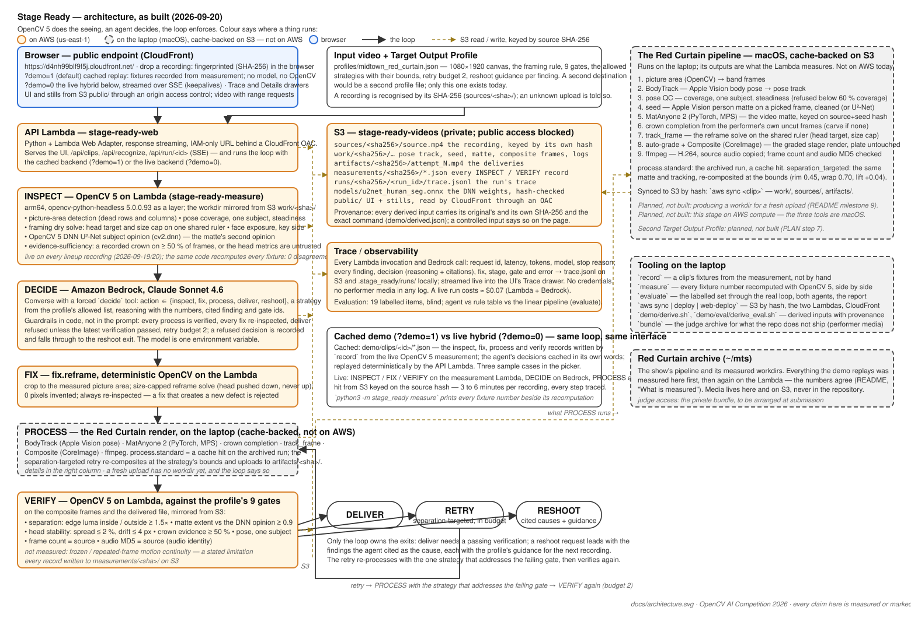

# Stage Ready — technical report

[Project and quick start](README.md) · [Architecture](docs/architecture.svg) ·
[Evaluation](demo/eval/EVALUATION.md) · [Demo video](https://www.youtube.com/watch?v=3vW55n17LIw)

## Problem and users

Show producers receive performer videos recorded with different framing, lighting, backgrounds,
and clothing. A fixed processing pipeline can finish successfully while producing an unusable
result. Stage Ready adds a measured acceptance loop around the existing Red Curtain pipeline
used for the Midtown Show: inspect the recording, choose a permitted action, verify the output,
and either deliver or request a specific reshoot.

The motivating example is Ethel's red clothing on the red-curtain background. Her first composite
measures only 1.13× subject/background luminance separation against a 1.50× minimum. A bounded
retry reaches 1.52×. That finished-output measurement changes the next action; a render's
successful completion is insufficient evidence for delivery.

The intended benefit is less manual quality-control work and fewer silently unsuitable
outputs. The current evaluation measures technical outcomes, not editor time saved or audience
response; those real-world benefits remain to be studied.

## Architecture

| Component | Responsibility | Execution |
| --- | --- | --- |
| Browser workspace | Recording recognition, sample selection, progress, trace, session results | Browser; static UI on CloudFront/S3 |
| API and loop | Stream events; enforce allowed actions, retry budget, verification-before-delivery | Python HTTP server, AWS Lambda Web Adapter |
| INSPECT / FIX / VERIFY | Image/video measurements, crop and framing solve, output gates | OpenCV 5 measurement Lambda, Python 3.12 arm64 |
| DECIDE | Select an action/strategy from evidence using the `decide` tool schema | Amazon Bedrock Converse, Claude Sonnet 4.6 |
| PROCESS | Reuse prepared matte/track/render or locally re-composite a bounded retry | External macOS pipeline; prepared outputs cached on S3 |
| Storage | Source-hash-keyed workdirs, outputs, measurements, traces, DNN weights | Private S3; only the designated `public/` prefix is served by CloudFront |

The public endpoint is https://d4nh99blf9f5j.cloudfront.net/. Its default mode replays committed,
measured fixtures. `?demo=0` runs new OpenCV measurements and Bedrock decisions against prepared
recordings. It does not produce a new render for an unknown upload. A newly dropped browser file
is fingerprinted locally; recognition sends a hash and filename, not the video bytes.

[Deployment instructions](docs/DEPLOYMENT.md) describe credentials, SDK/layer assembly, AWS
configuration, data synchronization, updates, and shutdown. The build vendors pinned SDK
packages, and the measurement layer carries OpenCV 5, NumPy, and a supplied arm64 FFmpeg.

## Target Output Profile

The single validated profile is [midtown_red_curtain.json](profiles/midtown_red_curtain.json):
1080 × 1920 output, H.264 CRF 20, copied source audio, a fixed curtain background, and bounded
framing/grade adjustments. The head target is 0.334 of canvas height and may move downward to
hold the shoulder-width cap of 0.55. Inspection and the framing solve share that size measurement.

| Verification gate | Required value |
| --- | --- |
| Pose coverage | ≥ 60% of frames |
| One subject | ≥ 95% of frames |
| Recorded crown evidence | ≥ 50% of frames |
| Matte extent / independent opinion | Median head-width ratio ≥ 0.90 |
| Subject/background separation | Edge luminance ratio ≥ 1.50× |
| Head-height spread | ≤ 2% of output height |
| Slow head drift | ≤ 4 px |
| Decoded frame count | Equal to source |
| Decoded-audio MD5 | Equal to source |

The crown rule is an evidence-sufficiency check: a cropped head can make the image boundary
look falsely stable. Below 50% recorded-crown coverage, inspection and verification refuse to
trust the head-motion metrics. The threshold is a conservative operational rule, not a validated
universal measure of framing quality. Five-to-twelve-percent headroom is capture guidance,
not an additional gate.

Three strategies are allowed: `fix.reframe`, `process.standard`, and
`process.separation_targeted`. The retry reuses seed/matte/track/warp, with rim ≤ 0.45,
light wrap ≤ 0.70, and shadow lift ≤ 0.040. The retry budget is two reprocesses. These values are
the profile's declared limits, not per-performer exceptions.

## Perception, decision, and action

1. INSPECT emits findings with values, thresholds, confidence, and provenance.
2. DECIDE receives the profile, current evidence, previous attempts/decisions, and remaining budget.
3. A FIX is re-inspected and rejected if it introduces a new failing finding.
4. Every PROCESS attempt is followed by VERIFY.
5. A failed verification returns to DECIDE. A permitted retry can change strategy; otherwise the
   result is a reshoot request with the measurement and capture guidance.
6. DELIVER is refused unless the latest verification passes. The model cannot waive this guard.

The orchestrator is [loop.py](stage_ready/loop.py); the interfaces and decision schema are in
[models.py](stage_ready/models.py). Cached and live backends use the same loop. Guards, reshoot
exits, deterministic replay, and the recovery path are covered by automated tests.

In [Ethel's live AWS trace](demo/eval/live/ethel_20260920T015147.jsonl), failed separation causes
the next decision to select `process.separation_targeted`; subsequent verification passes.
[Brian's trace](demo/eval/live/brian_padded_20260920T105604.jsonl) shows padding findings causing
a reframe and re-inspection. [Sandy's current trace](demo/eval/live/sandy_20260920T134021_crown_evidence.jsonl)
shows a reshoot at the first decision when the crown evidence is insufficient.

These are evidence-to-action workflows. The language model selects actions, while deterministic
code owns the gates and exits. The UI's Stop control stops the browser's run interaction; it is
not a guarantee that an already-running AWS invocation has been cancelled. Explicit human
approval and audited gate overrides remain roadmap work.

## Why OpenCV 5

[stage_ready/vision/](stage_ready/vision/) performs substantive analysis: picture-area detection,
pose-track quality checks, matte coverage and crown measurements, head stability, exposure/key
measurement, edge-luminance separation, and decoded frame counting. Pose tracks and mattes are
prepared inputs; the project does not claim that OpenCV generates the external pipeline's pose
track or propagates its video matte. FFmpeg supplies decoded-audio hashing because OpenCV does
not decode that audio stream for this gate.

`require_cv2()` refuses OpenCV 4. Desktop measurement is pinned to `opencv-python==5.0.0.93`;
headless/ Lambda measurement uses `opencv-python-headless==5.0.0.93`, with `numpy==2.4.6`.
The versions and reproduction commands are in [requirements/](requirements/) and
[REPRODUCING.md](docs/REPRODUCING.md).

`SubjectSegmenter` uses `cv2.dnn.readNet` for U²-Net human segmentation. It can generate a cleaned
seed and supplies the independent matte-extent opinion used by Lambda. Weights are fetched
separately and verified with their registered SHA-256. PP-HumanSeg remains a comparison model.

The September 19 segmentation comparison used Sandy, Ethel, and Zach's earlier black-shirt take,
in that order; it is distinct from the final picker lineup:

| Measurement | U²-Net, default | PP-HumanSeg |
| --- | --- | --- |
| Seed IoU against archived Apple Vision seed | 0.95 / 0.99 / 0.96 | 0.65 / 0.72 / 0.65 |
| Matte extent, median head-width ratio | 1.003 / 0.989 / 1.018 | 0.945 / 1.337 / 1.426 |
| Archived Vision ratios for comparison | 0.981 / 0.996 / 1.006 | Same reference |

`python -m stage_ready segcheck` runs the comparison on the selected current fixtures. The
reported historical values require the corresponding historical workdirs. U²-Net is close
enough for the independent coverage check; PP-HumanSeg is too coarse for these head bands.
The separation gate continues to use the pipeline's matte edge: a DNN silhouette shifted that
measurement by up to 0.14× on an upscaled input, enough to change a gate result. It remains a
cross-check rather than the accepted separation measurement.

## Evaluation

[The full evaluation](demo/eval/EVALUATION.md) contains 19 labelled cases: 16 real, derived, or
controlled inputs through the loop and three output-corruption checks. Inputs are labelled before
execution. Bedrock receives measurements without performer names, briefs, or source filenames
for this evaluation, reducing label leakage. Both Bedrock and a deterministic rule table use the
same measurement and verification implementation.

| Result | Bedrock agent | Rules baseline |
| --- | --- | --- |
| Outcomes matching labels | 17/19 | 17/19 |
| Silently wrong deliveries | 1, frozen frames | 1, frozen frames |
| Missed labelled findings | 1, short walk-in | 1, short walk-in |
| Wrong refusal | Seated performer during pose preparation | Same |

Both approaches reach the same final outcomes. Sandy's path differs: the agent stops at its
first decision; the rules baseline attempts the allowed reframe and then stops. This set shows
verification-driven behavior and bounded autonomy, not an outcome-accuracy gain from an LLM.

The linear pipeline baseline would ship 13 standard renders, six with failing gates. Two of
those six have labels saying they should not ship. The loop catches those failures through
reshoot or retry. Both approaches miss frozen frames when the total frame count is preserved.

The agent run recorded 30 Bedrock calls, approximately 139k input and 12k output tokens, and
about 12 minutes of local measurement/evaluation. The historical model-cost estimate was about
$0.60 for that set; it is not a current price quote. [Raw results](demo/eval/results/) retain
per-item measurements, timings, decisions, and scoring; [AWS traces](demo/eval/live/) separately
record the hosted workflow.

The earlier model-selection experiment remains in `demo/eval/agent_*.json`: Sonnet 4.6 scored
9/9 trusted decision states in two runs, Nova 2 Lite 18/27 across three repeats, and Nova Pro
21/27. Those files capture the older nine-state benchmark. `agent-eval` now captures the current
fixtures, so its state count and outcomes can differ from that historical experiment.

## Claim audit

| Claim | Implemented scope |
| --- | --- |
| OpenCV 5 does substantive analysis | Live inspection/verification and framing solve on prepared workdirs |
| AWS runs a meaningful component | Measurement Lambda, Bedrock decisions, API Lambda, S3, CloudFront |
| Visual evidence changes later actions | Reframe, retry, and reshoot traces supplied |
| Default demo is reproducible | Cached JSON replay, no runtime model calls or OpenCV measurements |
| New uploads are processed end to end | Not implemented; known-input recognition only |
| All processing runs on AWS | Not implemented; prepared renders are cached from the macOS pipeline |
| More than one output destination is validated | Not implemented; one Red Curtain profile |
| All technical defects are caught | False; frozen frames and one walk-in are documented misses |
| COOL acceleration | Not implemented or claimed |

## What comes from the Red Curtain pipeline

Stage Ready builds on an existing production workflow: BodyTrack/Apple Vision supplies the pose
track, MatAnyone propagates the matte on local MPS, and Composite renders via CoreImage.
The plate, framing style, and grade belong to the Red Curtain profile. Those tools and assets are
not distributed here. The Python vision modules port the measurements and framing solve;
OpenCV DNN supplies a portable segmentation opinion.

[demo/derived.json](demo/derived.json) records original hashes, time ranges, and edits for derived
inputs. [demo/derive.sh](demo/derive.sh) and [derive_eval.sh](demo/eval/derive_eval.sh) preserve the
commands for controlled inputs. Brian's padding is deliberately introduced and labelled in the
UI; Zach's demo input is an excerpt. Sandy's failure remains visible rather than being converted
to an unsupported success.

## Limitations and responsible use

This is a prepared-recording workflow with one profile and a small, show-specific evaluation.
It has no validated fairness/generalization study across capture conditions or demographics.
Human review remains necessary for semantic defects and corruption outside the nine gates.
It is not an identity, emotion, health, or talent classifier.

The browser supports local recognition of known inputs, not an unrestricted upload service.
In live mode, Bedrock receives numeric findings/profile information and demo metadata, not
video frames. Media and intermediate work remain in the operator's local archive/S3. Traces
record decisions, request IDs, and timing for review.

Performer media is excluded from Git and Python distributions and is not covered by the MIT
code license. The owner must provide judge access through an authorized restricted bundle and
ensure permission for the hosted footage/video. Model weights retain their upstream terms;
see [third-party notices](THIRD_PARTY_NOTICES.md).

The deployed app uses a private S3 bucket and IAM-authorized Lambda origins, but the public UI
has no user authentication or per-user rate limits. Live calls can incur costs. Production access
control, resource limits, retention/deletion, explicit human approval, new-upload rendering,
frozen-frame detection, and a second validated profile are tracked in the
[README roadmap](README.md#delivery-status-and-roadmap).
